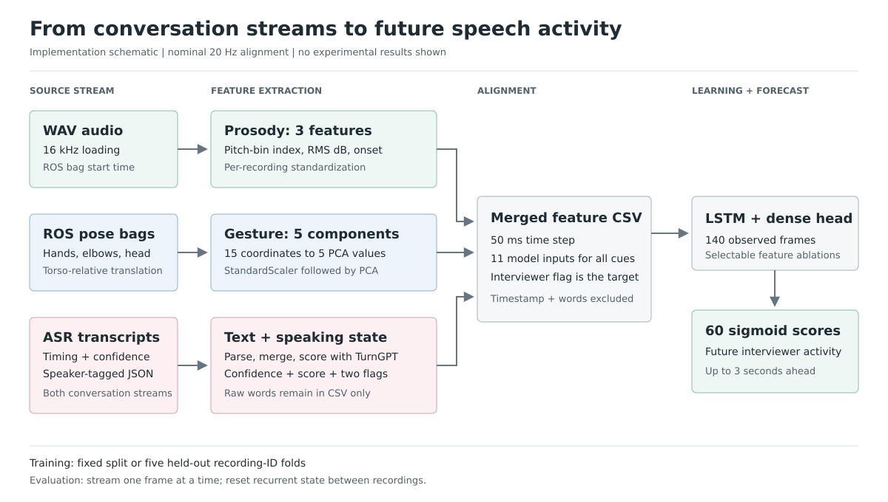
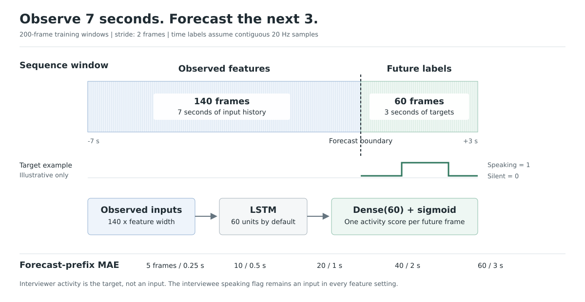

# Learning Turn-Taking from Human Demonstrations

Research code for teaching a social robot **when to speak** from human
demonstrations. The study uses job interviews to model an interviewer's timing,
rather than assuming every pause means the other person's turn has ended.

**Paper:** [Learning Turn-Taking Behavior from Human Demonstrations for Social Human-Robot Interactions](https://ieeexplore.ieee.org/abstract/document/9981243/)

**Authors:** Pourya Shahverdi, Alexander Tyshka, Madeline Trombly, and
Wing-Yue Geoffrey Louie, Oakland University.

## Approach and Architecture



The paper's system diagram (Figure 1) shows **learning from demonstration**:
record interviews with microphones and depth cameras, extract features, and
learn the interviewer's speaking behavior.

| Input | What it contributes |
| --- | --- |
| Voice (prosody) | Audio features describing pitch, energy, and changes in sound. |
| Text | Speech recognition confidence and a TurnGPT score indicating whether a word could end a turn. |
| Body position | Five principal components summarizing hand, elbow, and head positions relative to the torso. |
| Speaking activity | Whether the interviewee is speaking; included in every feature setting. |

The paper's model diagram (Figure 3) uses a **15-unit Long Short-Term Memory
(LSTM) layer** to track past inputs. A fully connected layer produces **60
independent sigmoid scores**, predicting speech activity in 50 ms steps over
the next 3 seconds.



Training uses 10-second windows: the first 7 seconds provide inputs and the
last 3 seconds provide interviewer speaking labels. Interviewer activity is a
target, not an input. A mean squared error loss trains the model to match these
labels.

For discrete speaking decisions, the system averages overlapping predictions
for the current time and applies a threshold. A 0.5-second accumulation window
worked best in the paper.

*The embedded diagrams summarize the code, not the paper's original figures.
The window diagram shows the code's 60-unit default; the paper uses 15 units.*

## What the Results Show

The dataset contains **28 minutes and 7 seconds of interviews with five students,
and 150 turns**. Five-fold cross-validation trains on four students and evaluates
on the fifth.

Selected **mean absolute errors (MAE)** from the paper are shown below. Lower
is better: values measure activity-prediction error across each forecast window,
not timing error in seconds. All rows include speaking activity.

| Feature set | 0.25 seconds | 1 second | 3 seconds |
| --- | ---: | ---: | ---: |
| Speaking activity only | 0.270 | 0.287 | 0.342 |
| Text | 0.272 | 0.290 | 0.343 |
| Voice | 0.263 | 0.281 | 0.335 |
| Body position | 0.327 | 0.351 | 0.396 |
| **Voice + text** | **0.258** | **0.278** | **0.334** |
| Voice + text + body position | 0.307 | 0.334 | 0.385 |

Published means, not new runs; see the paper for standard deviations and other
horizons.

- **Voice and text worked best:** This combination had the lowest mean absolute
	error at every tested horizon. Language scores complement audio cues when
	estimating whether a response is complete.
- **More inputs were not always better:** Adding body-position features increased
	error. The authors attribute this to overfitting: learning recording-specific
	patterns that do not carry over to new examples.
- **Activity accuracy is not decision accuracy:** The best MAE model favored
	precision (fewer false alarms) over recall (detecting more real turns).
	Thresholding and accumulation also affect performance.
- **Speech recognition affects timing:** Missed filler sounds such as "um" were
	treated as silence and could trigger an incorrect speaking decision.

## Getting Started

These are research scripts, not a packaged application. Recordings, processed
data, and trained models are not included, and dependencies are not locked.

- **Training and evaluation:** Legacy TensorFlow/Keras before Keras 3, NumPy,
	Matplotlib, and tqdm.
- **Feature preparation:** Also requires scikit-learn, a compatible legacy
	librosa release, PyYAML, ROS 1 Python tools, and TurnGPT/PyTorch with model
	weights. ROS extraction may need a separate environment.

Update paths under `/home/alex/turn-taking/data/` and
`/media/alex/easystore/Interview/`, and create output folders. Training expects
headerless `merged_features/AB_<id>_<run>.csv` files for IDs `1, 2, 4, 5, 6`
and runs `a, b, c`.

### Prepare the Data

Run each branch in order, then merge the outputs:

| Branch | Scripts |
| --- | --- |
| Audio | [extract_prosody.py](extract_prosody.py) |
| Body position | [extract_pose.py](extract_pose.py), then [pca.py](pca.py) |
| Transcripts | [google-text-parsing.py](google-text-parsing.py), [merge_text.py](merge_text.py), then [turngpt_score.py](turngpt_score.py) |
| Final alignment | [merge_all.py](merge_all.py) |

Merged CSVs contain timestamps, numeric features, speaking flags, and words.
Training excludes timestamps, words, and the interviewer speaking flag from
its inputs.

## Run Experiments

With prepared data and configured paths, train for 60 epochs using the paper's
stated hyperparameters, then evaluate all five folds:

```bash
mkdir -p logs
python train_kfold.py --dir experiment-01 --features nogesture \
	--units 15 --lr 0.005 --batch 4 --dropout 0.2 --regularization 0.001
python eval_kfold.py logs/experiment-01 --name experiment-01
```

`nogesture` selects voice, text, and speaking activity. Other options: `all`,
`prosody`, `gesture`, `asr`, `silence`. [train.py](train.py) supports a fixed
split but not `nogesture`.

Training saves models, settings, logs, and MAE plots under
`logs/experiment-01/k-<index>/<features>/`. Evaluation prints mean MAEs and saves
predictions and a precision-recall plot in the configured results directory.
Event matching uses a 0.5-second accumulation window and a two-second tolerance.
F1 plotting blocks are disabled.

## Reproduction Notes

- Training defaults differ from the paper. Keep `--units 15` to match both
	evaluation scripts, which hard-code that size.
- PCA currently fits all pose files. For gesture experiments, fit the scaler and
	PCA on training recordings only to avoid using held-out data.
- The loader currently zeros audio features when the interviewee speaking flag
	is `1`; verify this masking rule before interpreting new results.
- Use fresh experiment and result names: output folders and cached predictions
	can affect reruns. Random seeds are not fixed.